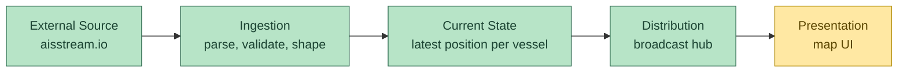
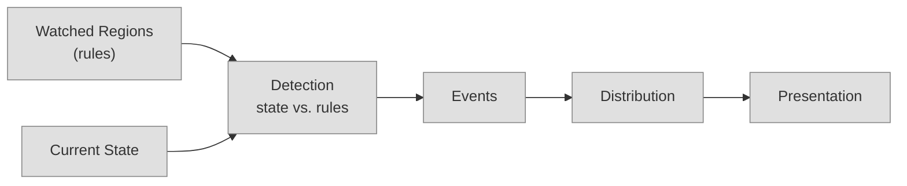

# System Design

**Status:** Draft — Phase 0
**Last updated:** 2026-09-16

## What this is

A digital twin: a live, queryable mirror of real-world vessel state, built
from AIS telemetry. Concretely: a streaming ingest pipeline with a
last-write-wins current-state store and pub/sub distribution to clients.

Historical movement replay (FR10) adds a persistent time-series store alongside
live state. Each AIS position report is a complete observation, so playback
reads observations in time order; full event sourcing is not required. The
in-memory store remains responsible for current positions and a short trail.
TimescaleDB will hold the durable history used for replay.

## Pipeline

🟢 done · 🟡 partial · ⚪ not started — see [Where we are now](#where-we-are-now)

The existing live pipeline has five roles:

- **External source** — something out there emitting vessel positions over
  time. (aisstream.io, currently.)
- **Ingestion** — the boundary between "their format" and "our format."
  Also where flaky/noisy data gets filtered before touching anything else.
- **Current state** — the single source of truth for "what does the
  system currently believe," per vessel.
- **Distribution** — however "current state changed" gets communicated
  outward to whoever's consuming it.
- **Presentation** — turns state into something a human can look at.

The planned history path records validated observations in TimescaleDB and
serves vessel/time-range queries through a history API to the playback UI.
History persistence is not implemented yet; it is the next backend milestone.

Later phases (watched regions / entry detection) add a second path that
*reads* Current State rather than replacing anything above:

## Decisions

Built and proven, not just proposed, unless noted otherwise:

- **Current state store:** in-memory, keyed by MMSI, one writer (ingest)
  and many readers (every connected client). A `sync.RWMutex`-guarded map
  — no channel-owned actor pattern needed at this scale. Trail entries
  use a fresh-allocation-on-append strategy so a `Snapshot()` reader can
  never race a concurrent `Upsert` on the same backing array. Race-tested
  (`go test -race`).
- **Ingestion API:** `ingest.Connect` returns a `*Connection` (a `Pings`
  channel + `Err()`), not a callback — the wiring from ingest's output to
  its consumers (`Store.Upsert`, `Hub.Broadcast`) is a visible loop in
  `main.go`, not threaded invisibly through a passed-in function.
- **Distribution:** a broadcast hub (`internal/api`) — a mutex-guarded
  set of connected clients, one goroutine per client (write loop +
  disconnect-detecting read loop), `Broadcast` skips a client whose
  buffer is full rather than blocking on it. Race-tested. Verified live
  against the real feed via a raw WebSocket client (`wscat`), not just
  in isolation.
- **Persistence (agreed 2026-09-16; not implemented):** TimescaleDB,
  starting directly with durable storage rather than an in-memory history
  prototype. Vessel observations belong in a hypertable partitioned by
  observation time, with an index supporting MMSI + time-range queries.
  Ordinary PostgreSQL tables in the same database can hold watched regions
  and recent events when those features are built. This supersedes the
  SQLite strawman. Learning time-series storage and modern backend operations
  is an explicit project goal, alongside keeping costs modest.
- **Serving the frontend:** the same Go binary serves it, no separate
  static host/CDN. Vite's job ends at `vite build` — producing a static
  `dist/` folder — it's not a production server. The backend serves
  those files directly (`http.FileServer`, same `mux` as `/health`,
  `/ws`, `/api`), keeping application serving in one deployment. A separate
  static host (Netlify/Vercel/S3+CloudFront)
  would add a second deployment target and CORS config for a scale
  benefit this project doesn't need.
- **Presentation:** MapLibre GL, not a custom three.js/WebGPU renderer —
  see roadmap.md Phase 8 for the full reasoning (industry-standard for
  this exact use case, built-in clustering and globe projection, and
  the custom-rendering skill this would have demonstrated is already
  covered elsewhere). A Web Worker owns the WebSocket connection and
  batches updates before handing them to the main thread — that's
  where the concurrency/performance work actually applies, since
  MapLibre's own rendering isn't something to inject custom code into.

## Infrastructure (agreed 2026-09-16; AWS not implemented)

Local Compose configuration and a backend Dockerfile are available; follow the
[local setup guide](./local-development.md). Configuration has been validated,
but container startup and database persistence still need runtime verification.

| Concern | Choice |
| --- | --- |
| Local development | Docker Compose running the Go backend and TimescaleDB, with a persistent database volume |
| Application hosting | Amazon ECS on Fargate |
| Database hosting | TimescaleDB in Docker on EC2, with a separate persistent EBS data volume |
| Container registry | Amazon ECR |
| Infrastructure as code | AWS CDK in TypeScript, deployed through CloudFormation |
| Logs and operational visibility | Amazon CloudWatch |
| Secrets | AWS Secrets Manager |
| Database backups | Backups to Amazon S3, with restore verification |

Deploy in one AWS region. Initially run one Go application task: ingestion,
the live vessel store, and WebSocket distribution currently share one process.
Adding replicas requires coordinating ingestion and sharing/distributing live
state; increasing the ECS task count alone is not sufficient.

The database has a separate lifecycle from application tasks. Retain its EBS
data volume across container/instance replacement and protect it from accidental
deletion in infrastructure changes. Recovery includes attaching the retained
volume to a replacement instance in the same availability zone or restoring a
backup. A persistent volume is not a backup; we own database upgrades, backups,
and recovery. This initial deployment does not provide database high availability.

ECS is the application host, not the initial database host. ECS-managed EBS
volumes for service tasks are deleted when their tasks terminate, which does
not fit a database that must retain data across redeployments. See
[AWS ECS EBS considerations](https://docs.aws.amazon.com/AmazonECS/latest/developerguide/ebs-volumes.html).
CDK provides the reproducible AWS setup; see the
[AWS CDK guide](https://docs.aws.amazon.com/cdk/v2/guide/home.html).

Build in order: local Compose and persistent observations, the replay API,
AWS infrastructure in CDK, then automated deployments. Playback UI builds on
the history API. Retention duration, capture scope, database sizing, and backup
schedule remain to be decided.

## Where we are now

- **External source:** connected — `ingest.go` holds a live WS connection
  to aisstream.io.
- **Ingestion:** done — typed, validated, shaped into `vessel.Ping` +
  identity. Known gap: no reconnect on failure yet (Phase 7).
- **Current state:** done — `internal/store`, race-tested.
- **History and AWS infrastructure:** choices agreed; implementation not started.
- **Distribution:** done — `internal/api` (WebSocket hub), race-tested
  and verified live.
- **Presentation:** design settled (MapLibre GL + Worker-based data
  pipeline), no code yet — this is the active phase (Phase 8).
